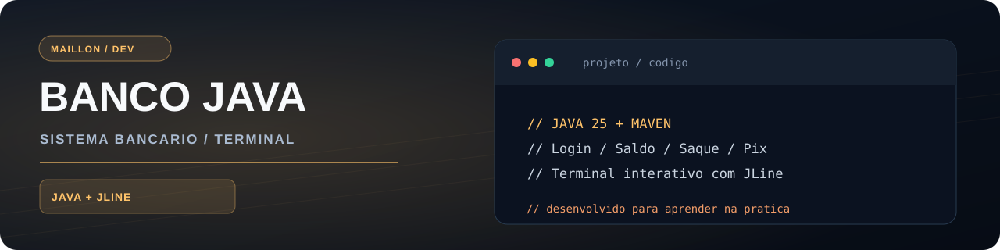
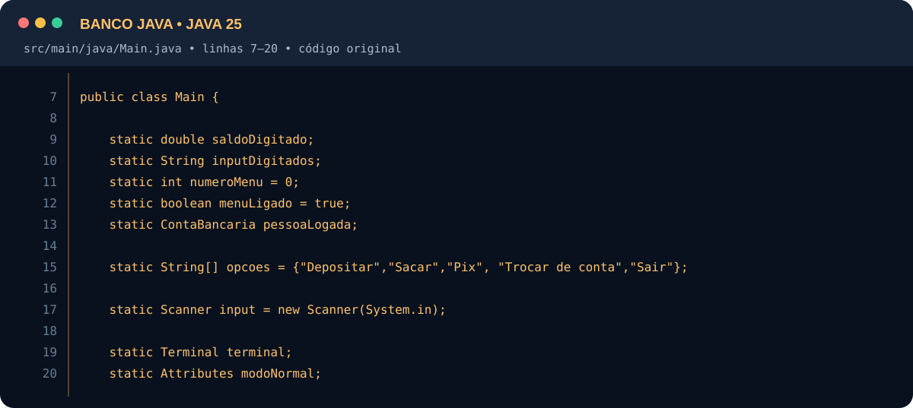
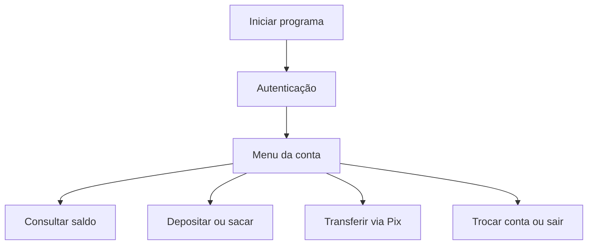

<p align="center">
  
</p>

<h1 align="center">Banco Java — Sistema Bancário no Terminal</h1>

<p align="center">
  
  
  
  
</p>

> Simulador bancário em Java com autenticação, operações financeiras fictícias e navegação interativa no terminal. Desenvolvido para praticar lógica, orientação a objetos e validações.

💻 **[Ver código](https://github.com/maillon49-prog/BancoJava)** · 📦 **[Ver versões para Windows](https://github.com/maillon49-prog/BancoJava/releases)**

## ✨ Funcionalidades

- 🔐 Login com número da conta e senha
- 👥 Múltiplas contas e troca entre usuários
- 💰 Consulta de saldo, depósito e saque
- 💸 Transferências Pix entre contas de demonstração
- 🛡️ Validação de saldo, valores e transferências para a própria chave
- ⌨️ Menu interativo com as setas do teclado usando JLine
- 🚪 Encerramento de sessão

## 🛠️ Tecnologias

| Linguagem | Build e dependências | Distribuição |
| :-- | :-- | :-- |
| Java 25 | Maven, JLine 4.4.3 | jpackage e WiX Toolset |

## 💻 Um trecho real do meu código

Imagem criada diretamente a partir do arquivo [`src/main/java/Main.java`](https://github.com/maillon49-prog/BancoJava/blob/main/src/main/java/Main.java#L7-L20), linhas 7–20. O conteúdo do trecho foi mantido exatamente como está no repositório.

<p align="center">
  
</p>

## 🧭 Fluxo de uso



## 🚀 Como executar

### Opção 1 — Código-fonte
**Requisitos:** JDK 25 e Maven.

```bash
git clone https://github.com/maillon49-prog/BancoJava.git
cd BancoJava
mvn package
java --enable-native-access=ALL-UNNAMED -jar target/BancoJava.jar
```

**Windows:** também existe o script `executar.ps1`, que compila e inicia o projeto pelo terminal.

### Opção 2 — Windows

Consulte a seção **[Releases](https://github.com/maillon49-prog/BancoJava/releases)** para a versão distribuída como instalador.

## 🧪 Contas fictícias para testes

| Conta | Número | Senha | Chave Pix |
| :-- | :-- | :-- | :-- |
| Maillon | `001` | `123` | `121212` |
| Antony | `002` | `456` | `565656` |

> ⚠️ Todas as contas e senhas acima são **fictícias e destinadas apenas a testes**. O projeto é educacional e não executa operações bancárias reais.

## 📁 Estrutura principal

```text
BancoJava/
├── src/main/java/Main.java
├── pom.xml
├── executar.ps1
└── README.md
```

## 🎯 O que pratiquei

Programação orientada a objetos, menus de terminal, validações, fluxo de operações e distribuição de aplicações Java.

---

### 👨‍💻 Autor

Desenvolvido por **Maillon Andrade de Oliveira**, como parte dos meus estudos e projetos práticos de programação.

[GitHub](https://github.com/maillon49-prog) · [Portfólio](https://github.com/maillon49-prog/Portifolio)
